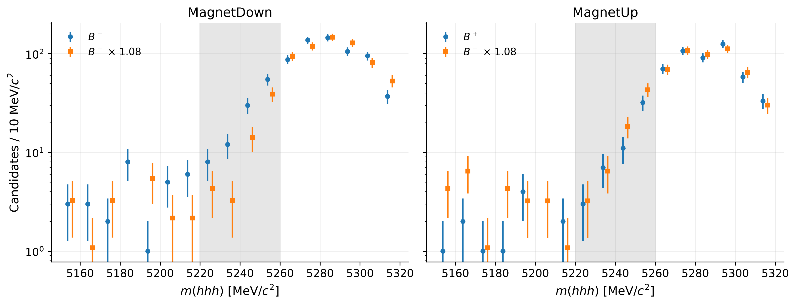
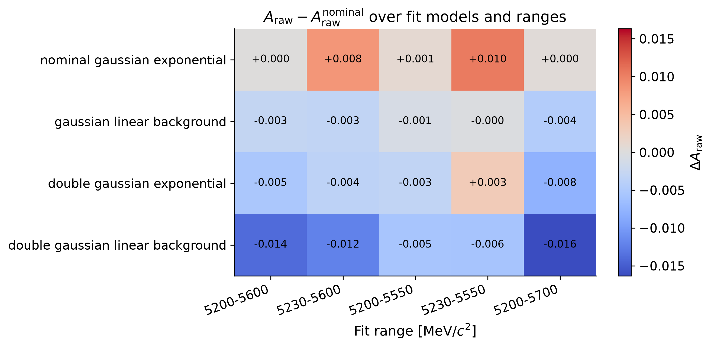

# Three-body B-meson decays with LHCb Open Data

A compact but complete flavour-physics analysis chain on CERN Open Data: ROOT
ntuples in, reconstructed invariant masses, binned maximum-likelihood fits,
simultaneous $B^+$/$B^-$ fits on both magnet polarities, a toy-MC validation of
the statistical machinery, a joint model × range systematic study, a test of the
charge dependence of the mass shape, and a local asymmetry diagnostic across the
Dalitz plane.

**[Full report (PDF)](report/main.pdf)** &nbsp;·&nbsp;
**[Slides (PDF)](slides/main.pdf)** &nbsp;·&nbsp;
Python, `uproot`, `iminuit`, `scikit-learn`, LaTeX

---

## Result

The raw charge asymmetry of $B^\pm \to h^\pm h^+ h^-$ candidates, from
simultaneous fits to the $B^+$ and $B^-$ mass spectra of each magnet polarity,
averaged over the two polarities:

$$A_{\mathrm{raw}} = -0.0321 \pm 0.0213\,\mathrm{(stat.)} \pm 0.0163\,\mathrm{(syst.)}$$

| Quantity | MagnetDown | MagnetUp |
| --- | --- | --- |
| Candidates read / selected / in fit range | 5 135 823 → 1 645 → 1 445 | 3 420 295 → 1 294 → 1 128 |
| $N(B^+)$ / $N(B^-)$ | 686 ± 28 / 641 ± 26 | 548 ± 24 / 515 ± 24 |
| $A_{\mathrm{raw}}$ | −0.0337 ± 0.0286 | −0.0305 ± 0.0315 |
| Goodness of fit, toy p-value | 0.025 | 0.30 |
| $B^+$/$B^-$ shape compatibility, toy p-value | 0.043 | 0.25 |

| Quantity | Value |
| --- | --- |
| Peak position / resolution, both polarities | 5284.7 ± 0.4 / 19.5 ± 0.4 MeV/$c^2$ |
| Systematic (joint model × range envelope) | 0.0163, over 20 accepted configurations |
| Toy-MC validation | 2000 toys, 0 failures, pull 0.98 wide, bias 2.6 % of σ |
| Local Dalitz diagnostic | 10×10 bins, 39 with ≥ 20 candidates, max \|significance\| = 2.6, global p = 0.27 |

**This is a raw asymmetry, not a CP-violation measurement.** Averaging the two
magnet polarities cancels polarity-odd detection asymmetries to first order, but
the result is not corrected for the kaon detection asymmetry that survives the
average, the $B^+/B^-$ production asymmetry, trigger and reconstruction
efficiencies, or selection-induced charge biases. It is quoted as a diagnostic of
the analysis chain. The [report](report/main.pdf) states what a real measurement
would additionally require.


---

## Analysis chain

| Step | What it does | Code |
| --- | --- | --- |
| Reconstruction | Four-vector sum of three tracks under a kaon mass hypothesis | [`src/reconstruction/invariant_mass.py`](src/reconstruction/invariant_mass.py) |
| Selection | Vertex quality, flight distance, kaon PID; shared by every study | [`src/physics/selection.py`](src/physics/selection.py) |
| Mass models | Gaussian / double-Gaussian signal, finite-range exponential and linear backgrounds | [`src/fitting/mass_models.py`](src/fitting/mass_models.py) |
| Fitting | Binned extended maximum-likelihood fit, multi-start MINUIT, fit-quality metrics | [`src/fitting/fit_mass.py`](src/fitting/fit_mass.py) |
| Asymmetry | Simultaneous $B^+$/$B^-$ fit with shared shapes; equal-weight polarity average | [`src/fitting/simultaneous.py`](src/fitting/simultaneous.py) |
| Acceptance | Criteria a variation must meet to define a systematic; Barlow correction | [`src/fitting/acceptance.py`](src/fitting/acceptance.py) |
| Dalitz kinematics | Charge-ordered $m^2_{\mathrm{low}}(K^+K^-)$, $m^2_{\mathrm{high}}(K^+K^-)$ | [`src/physics/dalitz.py`](src/physics/dalitz.py) |
| Classification | Sideband-labelled Random Forest | [`src/ml/signal_background.py`](src/ml/signal_background.py) |

Studies built on top of that: [charge fits](scripts/run_charge_separated_fits.py),
[toy-MC validation](studies/toy_mc/run_raw_asymmetry_toys.py),
[fit-model](studies/systematics/run_fit_model_variations.py),
[fit-range](studies/systematics/run_fit_range_variations.py) and
[joint](studies/systematics/run_joint_variations.py) systematics, the
[$B^+$/$B^-$ shape test](studies/charge_shape/run_charge_shape_test.py), and the
[local Dalitz asymmetry](studies/dalitz/run_local_raw_asymmetry.py).

## Results in detail

### Invariant-mass fit

The nominal model is a single Gaussian signal plus a finite-range exponential
background, fitted over $5200 < m(hhh) < 5600~\mathrm{MeV}/c^2$ by binned
extended maximum likelihood (MINUIT). On all 2573 selected candidates of both
polarities in that range, the fitted peak sits at 5284.7 ± 0.4 MeV/$c^2$, within
a few MeV of the known $B^\pm$ mass, which is the main closure check on the
reconstruction.

The fit starts at 5200 MeV/$c^2$ to exclude a structure between 5050 (where the
ntuple starts) and about 5180 MeV/$c^2$. It is symmetric between the charges and
falls off at the kinematic limit $m_B - m_\pi \approx 5140~\mathrm{MeV}/c^2$ of a
decay with a missed pion, the signature of partially reconstructed decays. A
common-mean **double Gaussian is not used as the nominal shape**: its wide
component (σ = 55 ± 10 MeV/$c^2$) takes over the combinatorial background, whose
fitted yield falls from 180 ± 21 to 63 ± 39. It is kept as a systematic variation.

### Simultaneous charge fits on both polarities

For each polarity the $B^+$ and $B^-$ spectra are fitted **simultaneously**:
the peak position, resolution and background slope are shared, each charge has
its own signal and background yields, and $A_{\mathrm{raw}}$ is a parameter of
the fit. A combinatorial background has no reason to look different for the two
charges. Fitting them separately instead let the $B^+$ background of MagnetDown
take a much steeper slope than the $B^-$ one (−9.5 against −6.0 per GeV/$c^2$), which absorbed a fluctuation into
the $B^+$ background and made the asymmetry depend on the fit range.

The two polarities are then averaged **with equal weights**. Reversing the magnet
swaps the side of the detector each charge bends towards, so a left-right
detection asymmetry enters the two polarities with opposite signs and cancels in
the unweighted average; a precision-weighted average would not cancel it, since
the samples differ in size. The two polarities agree: −0.0337 ± 0.0286 and
−0.0305 ± 0.0315.

### The low-mass shoulder of MagnetDown $B^+$

MagnetDown $B^+$ shows an excess on the low-mass flank of the peak: 105
candidates between 5220 and 5260 MeV/$c^2$, where the shared-shape fit expects
91, while $B^-$ has 56 for 73 expected. It is not $\bar D^0 \to K^+K^-$, and it
lies above the endpoint of the partially reconstructed structure.

A likelihood-ratio test of shared against charge-specific shapes, calibrated with
pseudo-experiments, gives **p = 0.043** on MagnetDown. The flank window was
chosen after looking at that spectrum, so this overstates the evidence, and the
independent **MagnetUp** sample settles it: no excess (53 candidates for 62
expected in $B^+$, 66 for 58 in $B^-$), p = 0.25. A physics effect would appear
in MagnetUp $B^+$ too, and a polarity-dependent detector effect would move to
MagnetUp $B^-$; neither happens at a significant level. The shoulder is treated as
a ~2σ fluctuation. It is the reason the MagnetDown fit is marginal (toy
p = 0.025).

One weaker pattern is recorded without being claimed: the $B^+$ and $B^-$ peak
positions differ by −2.5 ± 1.2 MeV/$c^2$ in MagnetDown and +1.8 ± 1.3 MeV/$c^2$
in MagnetUp. A sign flip with the polarity is what an uncalibrated
charge-dependent momentum scale would produce, but each value is only ~2σ.



### Systematics

The systematic comes from refitting with four mass models (single or double
Gaussian, exponential or linear background) on five fit ranges, each on both
polarities and averaged like the nominal. A configuration is only used if every
fit converges with a valid minimum, positive yields and
$\chi^2/\mathrm{ndof} < 2.5$ for each charge spectrum; all 20 pass. The model and
range sources are not assumed independent: the systematic is the largest shift
from the nominal over the whole grid, **0.0163**, reached by the double Gaussian
with a linear background on 5200–5700 MeV/$c^2$. The one-at-a-time shifts (model
0.014, range 0.0075 after the Barlow correction) are kept as diagnostics. With
shared shapes, every range shift is within 1.5 times the statistical spread the
change of sample alone produces.

The grid is dominated by MagnetDown: across the 20 configurations its asymmetry
ranges from −0.015 to −0.068, while MagnetUp stays between −0.023 and −0.032.




### Toy-MC validation

2000 pseudo-experiments are generated from each polarity's simultaneous fit,
refitted the same way and averaged over polarities. No fit fails; the asymmetry
pull has mean −0.03 and width 0.98, and the bias is −0.0005, 2.6 % of the
statistical uncertainty. The mean fitted uncertainty (0.0212) slightly exceeds
the spread of the fitted asymmetries (0.0207), so the quoted statistical
uncertainty is calibrated and, if anything, conservative. The same toys give the
goodness-of-fit p-values above: the χ² computed on the observed counts drops
empty bins and cannot be read off a χ² table here. This validates the
statistical extraction and the uncertainty propagation, not the detector
modelling.

### Local asymmetry across the Dalitz plane

Integrated asymmetries can hide larger local effects in multibody decays, since
interference between resonant amplitudes varies across phase space. The Dalitz
coordinates are the two opposite-sign $K^+K^-$ masses, identified from the
daughter charges and ordered low/high — the track labels in the ntuple carry no
meaning, and these are the variables that map onto each other under CP, so a
$B^+$ and a $B^-$ candidate in the same bin sit in the same region of phase space.
The $\phi(1020)$ band at $m^2_{\mathrm{low}} \approx 1.04~\mathrm{GeV}^2/c^4$ is
clearly visible.

A bin-by-bin counting asymmetry is computed on a 10×10 grid over the 2358
candidates of both polarities in the signal window 5245–5325 MeV/$c^2$, masking
bins with fewer than 20 candidates (39 bins survive). The counting asymmetry over
that window, −0.0348 ± 0.0206, agrees with the fit-based value. The largest local
significance is 2.6; with 39 bins inspected, the chance of at least one
fluctuation that large with no local asymmetry at all is 0.27. With no background
subtraction or efficiency correction on top of that, no structure is claimed.


### Signal/background classification

A Random Forest is trained on quality and PID variables (the mass is excluded, as
it defines the labels), using the central mass window as signal-like and the
sidebands as background-like, on MagnetDown. **It reaches AUC = 0.528, i.e.
essentially no separation**: the baseline cuts have already removed the
candidates the available features could discriminate, and only 755 labelled
candidates remain. The study is kept because the negative result is informative —
a useful classifier would have to be trained before the tight preselection, on a
looser sample. See the [roadmap](ROADMAP.md).

## Reproducing

The ROOT inputs are not tracked. Download the three files of the CERN Open Data
record [*Matter Antimatter Differences (B meson decays to three hadrons)*](https://opendata.cern.ch/record/4900)
(LHCb, 2017, [DOI 10.7483/OPENDATA.LHCB.AOF7.JH09](https://doi.org/10.7483/OPENDATA.LHCB.AOF7.JH09),
CC0) — `B2HHH_MagnetDown.root`, `B2HHH_MagnetUp.root` and
`PhaseSpaceSimulation.root` — into `data/raw/`, then:

```bash
python -m venv .venv && source .venv/bin/activate && pip install -r requirements.txt
```

```bash
python scripts/run_mass_fit.py                          # mass fit, both polarities pooled
python scripts/run_charge_separated_fits.py             # simultaneous B+/B- fits, raw asymmetry
python studies/toy_mc/run_raw_asymmetry_toys.py --n-toys 2000
python studies/systematics/run_fit_model_variations.py
python studies/systematics/run_fit_range_variations.py
python studies/systematics/run_joint_variations.py      # model x range grid
python studies/systematics/summarize_systematics.py     # uncertainty budget
python studies/charge_shape/run_charge_shape_test.py    # B+/B- shape test per polarity
python studies/dalitz/run_local_raw_asymmetry.py        # local Dalitz diagnostic
```

Numerical outputs land in `results/` as JSON and CSV; those summaries are tracked
so every number quoted above can be checked against the file that produced it.
The exploratory notebooks (`notebooks/01`, `03`, `04`, `05`) run in the same
environment via `jupyter lab` and write their figures to `figures/`; they use
MagnetDown only.

The reconstruction, selection, mass models, simultaneous fit and asymmetry
propagation are covered by unit tests, including closure tests that fit
pseudo-data generated from known parameters and check that the fit recovers them
with correctly calibrated uncertainties:

```bash
pytest tests/
```

## Repository layout

```text
lhcb-b2hhh-analysis/
├── src/                    # reusable analysis code
│   ├── reconstruction/     # invariant-mass reconstruction
│   ├── physics/            # baseline selection, Dalitz kinematics
│   ├── fitting/            # mass models, single and simultaneous fits, acceptance
│   ├── ml/                 # sideband-labelled classifier
│   ├── plotting/           # figure helpers
│   └── utils/              # project paths and JSON output
├── scripts/                # mass fit and simultaneous charge fits
├── studies/                # toy MC, systematics, charge-shape test, local Dalitz asymmetry
├── notebooks/              # exploratory analysis, kept with outputs
├── results/                # JSON/CSV summaries (figures regenerated locally)
├── tests/                  # unit tests of the reconstruction, models and fits
├── figures/                # analysis figures
├── report/                 # LaTeX report (main.pdf)
├── slides/                 # Beamer presentation (main.pdf)
└── data/raw/               # ROOT inputs, not tracked
```

## Physics context

Charged $B$ mesons decaying to three hadrons are a sensitive probe of CP
violation: resonant and non-resonant amplitudes interfere across the Dalitz
plane, and that interference can produce large local asymmetries even when the
integrated one is small. Comparing $B^+$ and $B^-$ yields is the first step
of such an analysis; everything between that comparison and a physics result is
correction and control work, which this project documents rather than performs.

## License

Code under the [MIT licence](LICENSE). The input data are released by the LHCb
collaboration under CC0 through the [CERN Open Data Portal](https://opendata.cern.ch/record/4900).
