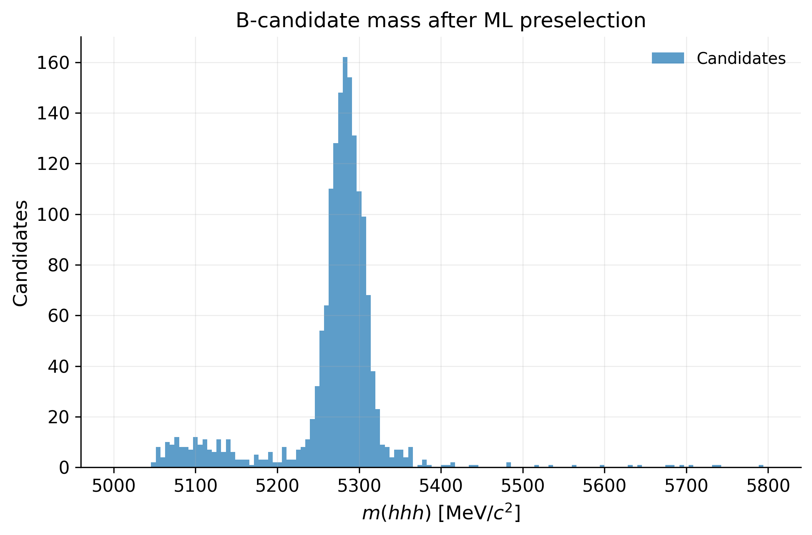
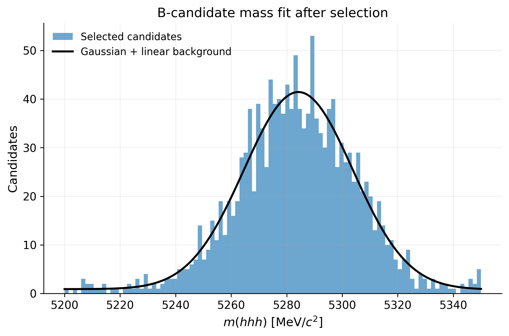
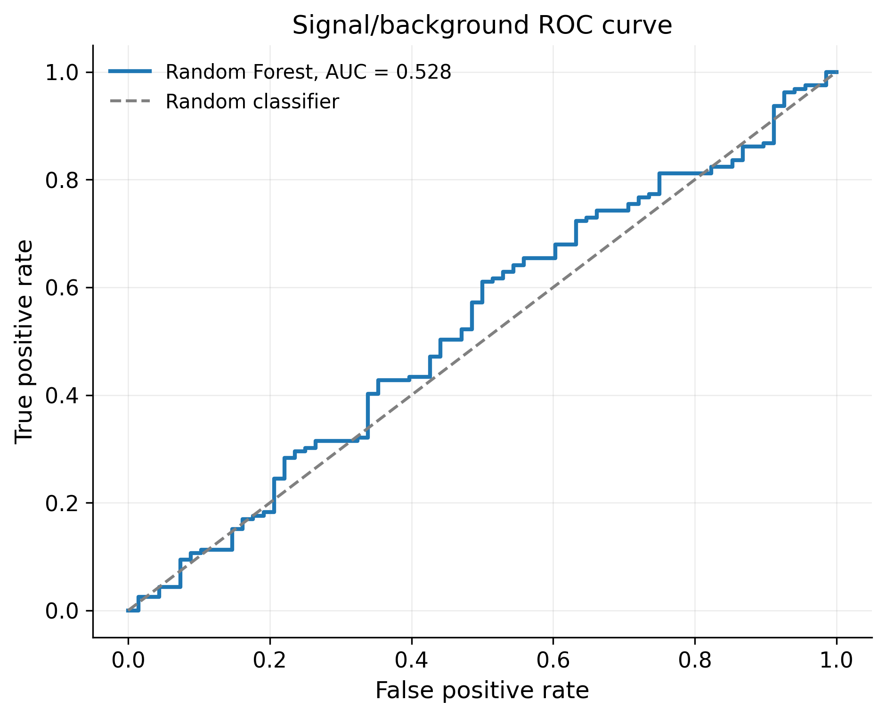
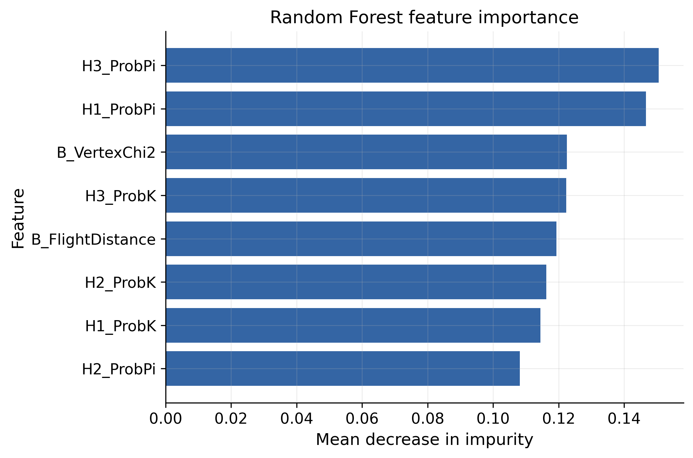
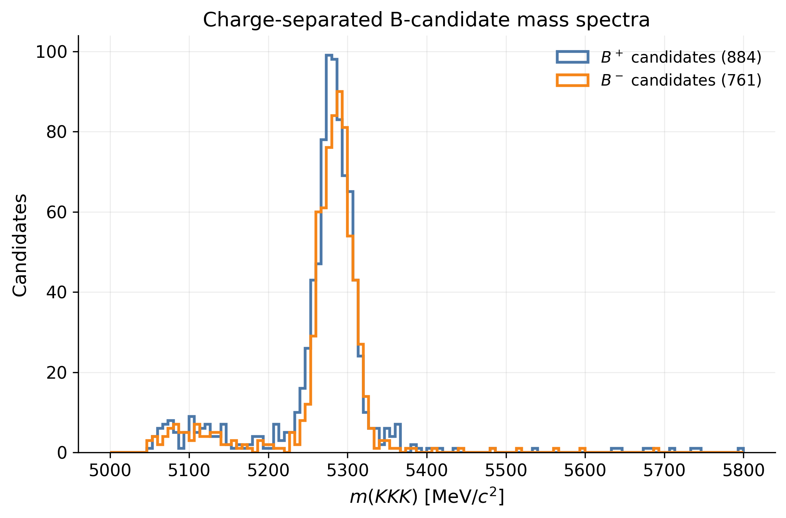
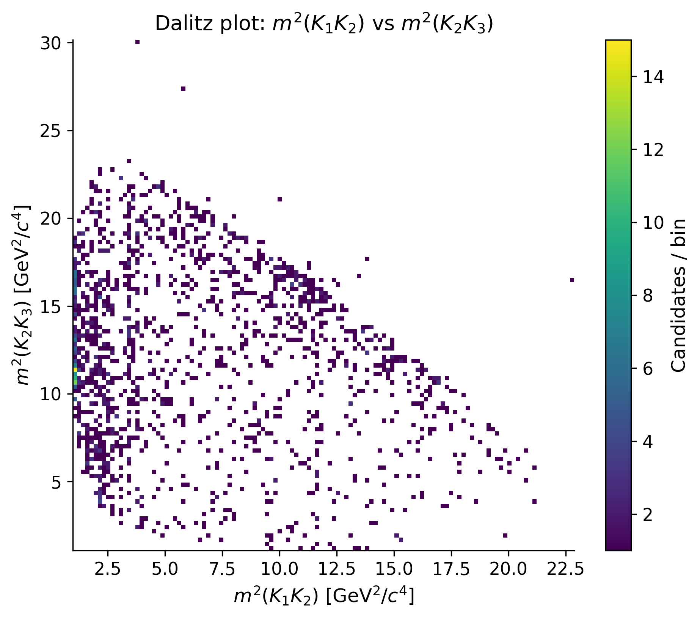

# LHCb B -> hhh Analysis

Modern Python workflow for a compact experimental particle-physics analysis using CERN Open Data from LHCb. The project reconstructs three-body B-meson candidates, studies the invariant-mass spectrum, builds a sideband-labelled signal/background classifier, and extends the workflow toward CP-asymmetry and Dalitz-plot studies.

## Physics Context

Heavy-flavour decays are a central probe of flavour physics, CP violation, and possible indirect effects of physics beyond the Standard Model. This project focuses on reconstructed B-meson candidates decaying into three charged hadrons, using a simple kaon-mass hypothesis for the daughters. The analysis follows the structure of a small HEP workflow: ROOT data loading, candidate selection, invariant-mass reconstruction, signal modelling, charge-separated comparisons, phase-space visualisation, and machine-learning diagnostics.

## Dataset

The input samples are LHCb Open Data ROOT ntuples stored in `data/raw/`:

- `B2HHH_MagnetDown.root`
- `B2HHH_MagnetUp.root`
- `PhaseSpaceSimulation.root`

The main notebooks use the `DecayTree` from `B2HHH_MagnetDown.root`. The additional samples are kept for future extensions such as magnet-polarity comparisons, acceptance studies, or simulation-based checks.

## Objectives

- Explore the ROOT tree and document relevant reconstructed branches.
- Reconstruct the invariant mass of B -> hhh candidates.
- Apply transparent physics-motivated quality and PID selections.
- Fit the selected B-candidate mass spectrum with a Gaussian signal plus linear background model.
- Define a signal window and sideband regions for labelled ML studies.
- Train and evaluate a Random Forest signal/background classifier.
- Compare B+ and B- candidates through a raw integrated CP-asymmetry estimator.
- Build pairwise invariant-mass variables for Dalitz-plot studies.
- Produce publication-style figures saved in `figures/`.

## Methods

### Invariant-Mass Reconstruction

The B-candidate mass is computed from the relativistic four-vector sum of the three daughter tracks:

```text
m_B^2 = E_total^2 - |p_total|^2
```

The helper function `compute_b_mass(df)` in `src/reconstruction/invariant_mass.py` performs this calculation using the daughter momentum branches `H*_PX`, `H*_PY`, and `H*_PZ`.

### Event Selection

The baseline selection keeps candidates with:

- good B-vertex quality,
- sizable flight distance,
- daughter tracks compatible with the kaon PID hypothesis.

These cuts are intentionally simple and interpretable, making the workflow suitable for a portfolio or thesis-application project.

### Signal/Background Classification

The notebook `notebooks/03_signal_background.ipynb` builds proxy labels from mass regions:

- signal-like candidates: central B-mass window,
- background-like candidates: lower and upper mass sidebands.

The classifier uses reconstruction-quality and PID variables, excluding the mass itself to avoid learning the label definition directly.

### CP Asymmetry

The notebook `notebooks/04_cp_asymmetry.ipynb` separates candidates by total reconstructed charge:

- B+ candidates have total daughter charge +1,
- B- candidates have total daughter charge -1.

It overlays the B+ and B- invariant-mass spectra and computes a simple raw integrated asymmetry in the signal window:

```text
A_CP = (N(B-) - N(B+)) / (N(B-) + N(B+))
```

This is a first diagnostic quantity. A realistic measurement would fit signal yields, subtract backgrounds, combine magnet polarities, and correct detector and production asymmetries.

### Dalitz-Plot Analysis

The notebook `notebooks/05_dalitz_analysis.ipynb` reconstructs the pairwise two-body invariant-mass-squared variables:

- `m_K1K2_sq`
- `m_K2K3_sq`
- `m_K1K3_sq`

These variables are used to produce Dalitz-style two-dimensional density maps. The reusable kinematic functions live in `src/physics/dalitz.py`.

## Example Figures

Mass reconstruction after selection:



Signal-plus-background mass fit:



Signal/background ROC curve:



Random Forest feature importance:



Charge-separated B-candidate mass spectra:



Dalitz density map:



## Project Structure

```text
lhcb-b2hhh-analysis/
├── data/
│   ├── raw/                  # ROOT inputs, ignored by Git
│   └── processed/            # derived tables, ignored by Git
├── figures/                  # saved analysis figures
├── notebooks/
│   ├── 01_data_exploration.ipynb
│   ├── 02_mass_reconstruction.ipynb
│   ├── 03_signal_background.ipynb
│   ├── 04_cp_asymmetry.ipynb
│   ├── 05_dalitz_analysis.ipynb
│   └── 05_machine_learning.ipynb
├── reports/
├── src/
│   ├── physics/
│   │   ├── dalitz.py
│   │   └── selection.py
│   ├── reconstruction/
│   │   └── invariant_mass.py
│   ├── plotting/
│   │   └── mass_plots.py
│   └── ml/
│       └── signal_background.py
├── environment.yml
├── requirements.txt
└── README.md
```

## Technologies

- ROOT files for HEP ntuple storage
- `uproot` for reading ROOT data in Python
- `pandas` for tabular event processing
- `numpy` and `scipy` for numerical reconstruction and fitting
- `matplotlib` for publication-style plots
- `scikit-learn` for Random Forest classification

## Installation

Using `conda`:

```bash
conda env create -f environment.yml
conda activate lhcb-b2hhh
python -m ipykernel install --user --name lhcb-b2hhh --display-name "Python (lhcb-b2hhh)"
```

Using `pip`:

```bash
python -m venv .venv
source .venv/bin/activate
pip install -r requirements.txt
python -m ipykernel install --user --name lhcb-b2hhh --display-name "Python (lhcb-b2hhh)"
```

## Running the Analysis

Start JupyterLab from the project root:

```bash
jupyter lab
```

Recommended notebook order:

1. `notebooks/01_data_exploration.ipynb`
2. `notebooks/02_mass_reconstruction.ipynb`
3. `notebooks/03_signal_background.ipynb`
4. `notebooks/04_cp_asymmetry.ipynb`
5. `notebooks/05_dalitz_analysis.ipynb`

Figures are saved automatically in `figures/`.

## Notes for GitHub

ROOT files and processed data products are ignored by Git to keep the repository lightweight. The README references figures in `figures/`, so keep representative output plots tracked when preparing the public repository.
