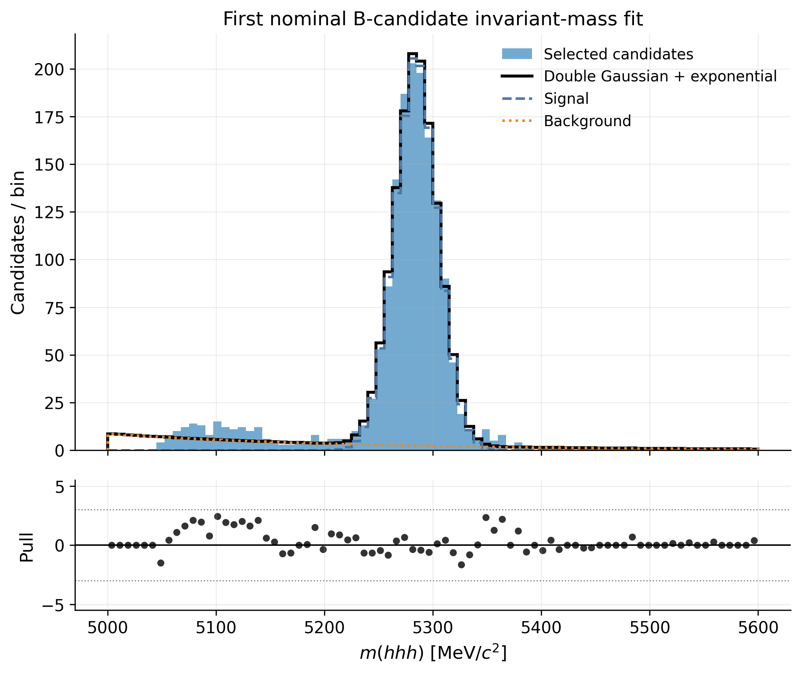
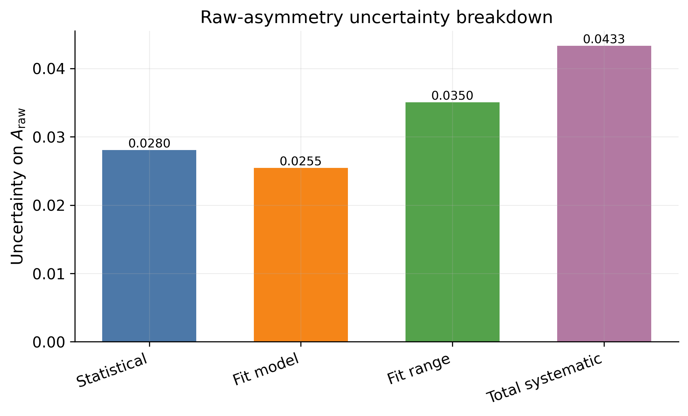
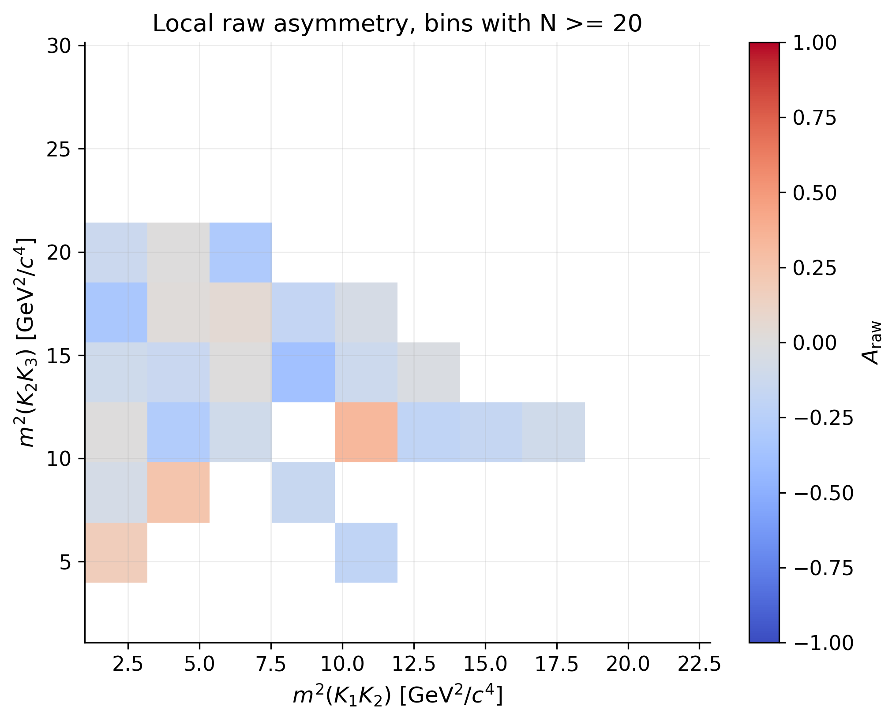

# Three-body B-meson decays with LHCb Open Data

A compact but complete flavour-physics analysis chain on CERN Open Data: ROOT
ntuples in, reconstructed invariant masses, binned maximum-likelihood fits,
charge-separated yields, a toy-MC validation of the statistical machinery, two
systematic studies, and a local asymmetry diagnostic across the Dalitz plane.

**[Full report (PDF)](report/main.pdf)** &nbsp;·&nbsp;
**[Slides (PDF)](slides/main.pdf)** &nbsp;·&nbsp;
Python, `uproot`, `iminuit`, `scikit-learn`, LaTeX

---

## Result

The raw charge asymmetry of $B^\pm \to h^\pm h^+ h^-$ candidates, extracted
from independent fits to the $B^+$ and $B^-$ mass spectra:

$$A_{\mathrm{raw}} = -0.0408 \pm 0.0281\,\mathrm{(stat.)} \pm 0.0433\,\mathrm{(syst.)}$$

| Quantity | Value |
| --- | --- |
| Candidates read / selected | 5 135 823 → 1 645 |
| Signal yield, nominal fit | 1378 ± 38 |
| Fitted peak position | 5284.4 ± 0.6 MeV/$c^2$ |
| $N(B^+)$ / $N(B^-)$ | 694 ± 27 / 640 ± 26 |
| $\chi^2/\mathrm{ndof}$ ($B^+$ / $B^-$) | 1.42 / 0.79 |
| Systematics (model / range / total) | 0.0255 / 0.0350 / 0.0433 |
| Toy-MC validation | 100 toys, 0 failures, pull width 1.05, bias −0.0025 |
| Local Dalitz diagnostic | 10×10 bins, 26 above threshold, max \|significance\| = 3.5 |

**This is a raw asymmetry, not a CP-violation measurement.** It is not corrected
for detector-induced charge asymmetries, $B^+/B^-$ production asymmetry,
trigger and reconstruction efficiencies, or selection-induced charge biases, and
it uses a single magnet polarity. It is quoted as a diagnostic of the analysis
chain. The [report](report/main.pdf) states what a real measurement would
additionally require.



---

## Analysis chain

| Step | What it does | Code |
| --- | --- | --- |
| Reconstruction | Four-vector sum of three tracks under a kaon mass hypothesis | [`src/reconstruction/invariant_mass.py`](src/reconstruction/invariant_mass.py) |
| Selection | Vertex quality, flight distance, kaon PID; shared by every study | [`src/physics/selection.py`](src/physics/selection.py) |
| Mass models | Gaussian / double-Gaussian signal, finite-range exponential and linear backgrounds | [`src/fitting/mass_models.py`](src/fitting/mass_models.py) |
| Fitting | Binned extended maximum-likelihood fit, pulls, fit-quality metrics | [`src/fitting/fit_mass.py`](src/fitting/fit_mass.py) |
| Dalitz kinematics | Pairwise invariant-mass-squared variables | [`src/physics/dalitz.py`](src/physics/dalitz.py) |
| Classification | Sideband-labelled Random Forest | [`src/ml/signal_background.py`](src/ml/signal_background.py) |

Studies built on top of that: [charge-separated fits](scripts/run_charge_separated_fits.py),
[toy-MC validation](studies/toy_mc/run_raw_asymmetry_toys.py),
[fit-model](studies/systematics/run_fit_model_variations.py) and
[fit-range](studies/systematics/run_fit_range_variations.py) systematics, and the
[local Dalitz asymmetry](studies/dalitz/run_local_raw_asymmetry.py).

## Results in detail

### Invariant-mass fit

The nominal model is a common-mean double Gaussian for the signal plus a
finite-range exponential background, fitted over
$5000 < m(hhh) < 5600~\mathrm{MeV}/c^2$ by binned maximum likelihood. The
fitted peak sits at 5284.4 ± 0.6 MeV/$c^2$, within a few MeV of the known
$B^\pm$ mass, which is the main closure check on the reconstruction.

### Charge-separated fits and systematics

The $B^+$ and $B^-$ spectra are fitted independently and the raw asymmetry is
built from the fitted yields. Two systematic categories are evaluated by
refitting: the mass-fit model and the fit range. A variation is only used if both
charge fits converge with positive yields and $\chi^2/\mathrm{ndof} < 2.5$; a
single-Gaussian stress test is reported but rejected on that criterion. The fit
range dominates the budget.



### Toy-MC validation

100 pseudo-experiments are generated from the nominal fitted model with the
measured yields injected, then refitted with the same model. No fit failures; the
asymmetry pull has mean −0.049 and width 1.05, and the bias (−0.0025) is an order
of magnitude below the statistical uncertainty. This validates the statistical
extraction and the uncertainty propagation, not the detector modelling.

### Local asymmetry across the Dalitz plane

Integrated asymmetries can hide larger local effects in multibody decays, since
interference between resonant amplitudes varies across phase space. A bin-by-bin
counting asymmetry is computed on a 10×10 grid, masking bins with fewer than 20
candidates (26 bins survive). The largest local significance is 3.5, on 26
inspected bins and with no background subtraction, efficiency correction or
look-elsewhere treatment — so no structure is claimed.



### Signal/background classification

A Random Forest is trained on quality and PID variables (the mass is excluded, as
it defines the labels), using the central mass window as signal-like and the
sidebands as background-like. **It reaches AUC = 0.528, i.e. essentially no
separation**: the baseline cuts have already removed the candidates the available
features could discriminate, and only 755 labelled candidates remain. The study
is kept because the negative result is informative — a useful classifier would
have to be trained before the tight preselection, on a looser sample. See the
[roadmap](ROADMAP.md).

## Reproducing

The ROOT inputs are not tracked. Place `B2HHH_MagnetDown.root`,
`B2HHH_MagnetUp.root` and `PhaseSpaceSimulation.root` from the CERN Open Data
Portal under `data/raw/`, then:

```bash
python -m venv .venv && source .venv/bin/activate && pip install -r requirements.txt
```

```bash
python scripts/run_mass_fit.py                          # nominal fit
python scripts/run_charge_separated_fits.py             # B+ / B- fits, raw asymmetry
python studies/toy_mc/run_raw_asymmetry_toys.py --n-toys 100
python studies/systematics/run_fit_model_variations.py
python studies/systematics/run_fit_range_variations.py
python studies/systematics/summarize_systematics.py     # uncertainty budget
python studies/dalitz/run_local_raw_asymmetry.py        # local Dalitz diagnostic
```

Numerical outputs land in `results/` as JSON and CSV; those summaries are tracked
so every number quoted above can be checked against the file that produced it.
The exploratory notebooks (`notebooks/01`, `03`, `04`, `05`) run in the same
environment via `jupyter lab` and write their figures to `figures/`.

## Repository layout

```text
lhcb-b2hhh-analysis/
├── src/                    # reusable analysis code
│   ├── reconstruction/     # invariant-mass reconstruction
│   ├── physics/            # baseline selection, Dalitz kinematics
│   ├── fitting/            # mass models and the binned likelihood fit
│   ├── ml/                 # sideband-labelled classifier
│   └── plotting/           # figure helpers
├── scripts/                # nominal and charge-separated fits
├── studies/                # toy MC, systematics, local Dalitz asymmetry
├── notebooks/              # exploratory analysis, kept with outputs
├── results/                # JSON/CSV summaries (figures regenerated locally)
├── figures/                # analysis figures
├── report/                 # LaTeX report (main.pdf)
├── slides/                 # Beamer presentation (main.pdf)
└── data/raw/               # ROOT inputs, not tracked
```

## Physics context

Charged $B$ mesons decaying to three hadrons are a sensitive probe of CP
violation: resonant and non-resonant amplitudes interfere across the Dalitz
plane, and that interference can produce large local asymmetries even when the
integrated one is small. Comparing $B^+$ and $B^-$ yields is the first step
of such an analysis; everything between that comparison and a physics result is
correction and control work, which this project documents rather than performs.

## License

[MIT](LICENSE). Data courtesy of the CERN Open Data Portal.
